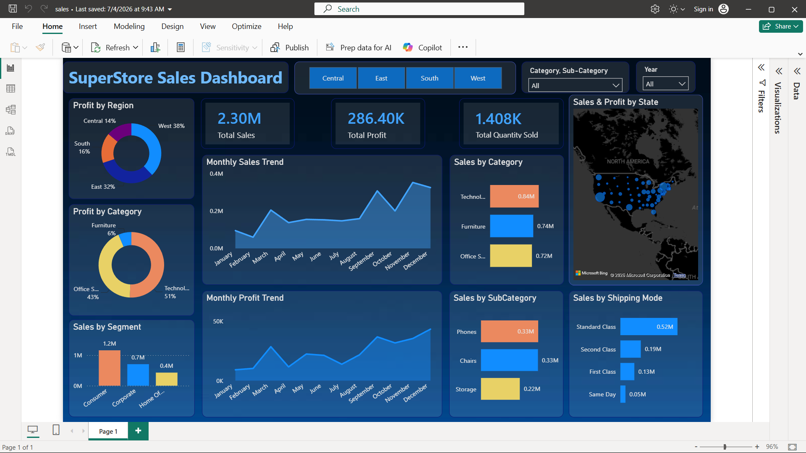

# SuperStore Sales Dashboard | Power BI

## Project Overview
An interactive sales analytics dashboard developed using Microsoft Power BI to explore sales performance, profitability, regional trends, product categories, customer segments, and shipping methods.

## Dashboard Preview

## Key Performance Indicators (KPIs)
- **Total Sales:** 2.30M
- **Total Profit:** 286.40K
- **Total Quantity Sold:** 1.408K

*Values are displayed as shown in the dashboard.*

## Dashboard Features
- **Regional Profit Analysis:** Compare profit contribution across Central, East, South, and West regions.
- **Monthly Sales Trend:** Analyze sales patterns throughout the year.
- **Monthly Profit Trend:** Track monthly profitability.
- **Category Analysis:** Compare sales and profit across Technology, Furniture, and Office Supplies.
- **Subcategory Analysis:** Examine performance of products such as Phones, Chairs, and Storage.
- **Customer Segment Analysis:** Compare Consumer, Corporate, and Home Office sales.
- **Shipping Mode Analysis:** Evaluate sales by Standard Class, Second Class, First Class, and Same Day.
- **Geographic Analysis:** Explore sales and profit distribution by state.

## Interactive Filters
- Region
- Category and Sub-Category
- Year

## Tools & Technologies
- Microsoft Power BI
- DAX, if used in the report
- Data visualization and business analytics

## How to View the Project
1. Download `sales.pbix` from this repository.
2. Open the file using Microsoft Power BI Desktop.
3. Interact with the charts and filters to explore sales performance.

## Project Objective
To transform sales data into an interactive dashboard that supports performance monitoring and helps identify trends across regions, products, customers, and shipping methods.

## Author
Mann Damani
